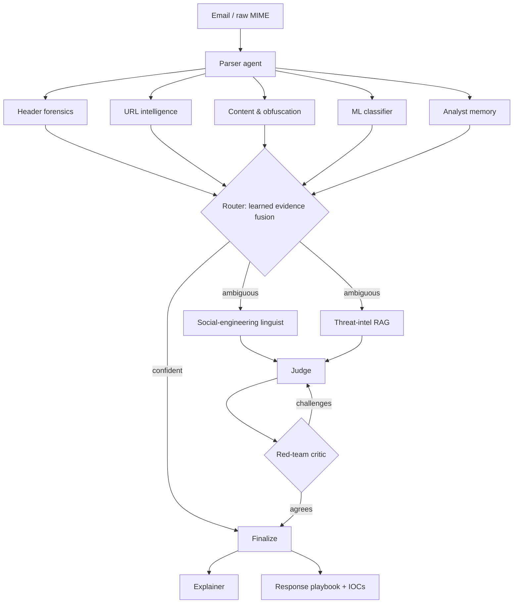
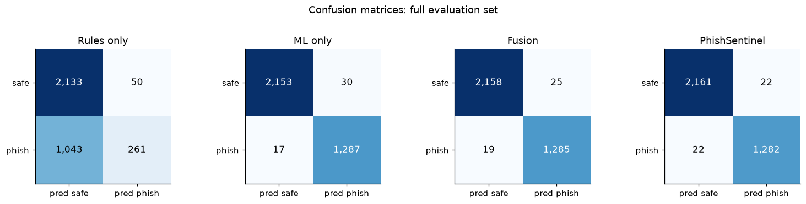
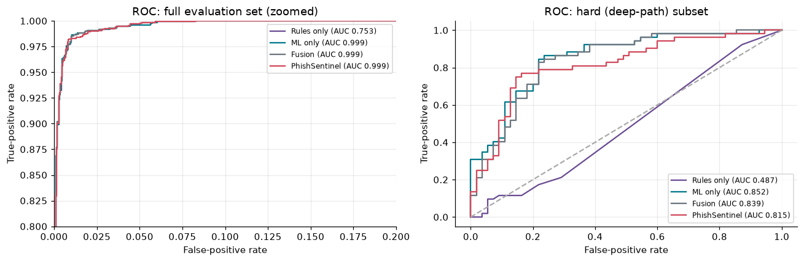
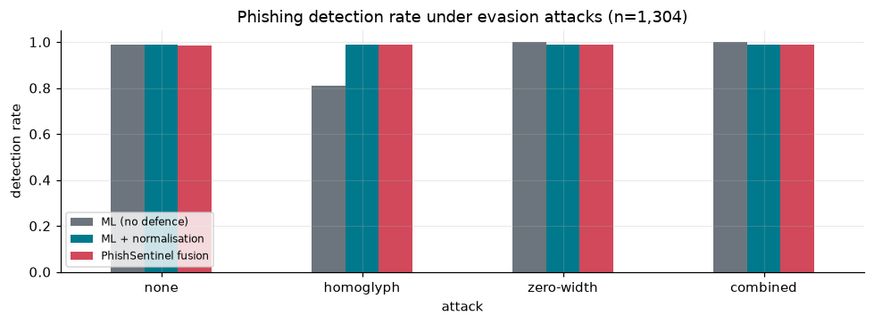
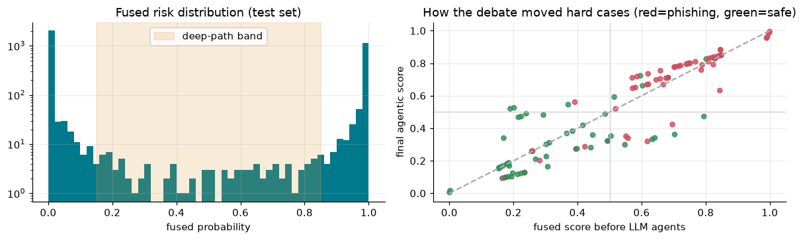
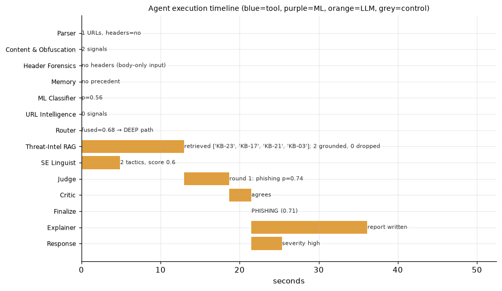

# 🛡️ PhishSentinel: Agentic AI-Based Phishing Email Detection and Explanation System

A multi-agent system built on **LangGraph** that detects phishing emails and explains its verdicts, working the way a SOC team would.

- Forensic tool agents (headers, URLs, content and obfuscation) and an ML classifier run in parallel.
- A learned evidence-fusion router sends only ambiguous emails to the LLM agents.
- The LLM agents are a social-engineering linguist, a RAG threat-intelligence agent grounded in MITRE ATT&CK, and a Judge ↔ red-team Critic debate.
- An explainer and a responder produce a plain-English explanation, IOCs and a response playbook.

[](https://github.com/Suhas29wasnotavailable/PhishSentinel-agentic-phishing-detection/actions/workflows/tests.yml)

📓 **Everything is in [`PhishSentinel_Agentic_Phishing_Detection.ipynb`](PhishSentinel_Agentic_Phishing_Detection.ipynb)**, executed with all outputs saved.

## Architecture


## Repository layout
| Path | Contents |
|---|---|
| `PhishSentinel_Agentic_Phishing_Detection.ipynb` | The full system: dataset, ML, RAG, LLM agents, LangGraph workflow, evaluation |
| `phishsentinel/` | Importable deterministic core: parser, Unicode normalisation, forensic signals, CLI |
| `tests/` | Unit tests for the core (run in GitHub Actions) |
| `docs/figures/` | Evaluation figures exported from the notebook |

## Command-line evidence ledger
The deterministic core has no dependencies:
```bash
pip install .
phishsentinel suspicious_email.eml          # or: cat email.txt | phishsentinel --json
phishsentinel inbox/*.eml                   # riskiest-first summary, one line per email
phishsentinel mail.eml --fail-above 0.8     # exit code 2 at or above the risk threshold
phishsentinel mail.eml --iocs               # defanged URLs, domains, IPs, senders and attachment hashes
```
```
Rule-engine risk: 0.83  (log-odds +2.6)  ·  headers: no  ·  URLs: 1
  [+2.0] URL      raw_ip_link                      http://192.0.2.10/page
  [+0.6] Content  call_to_action                   “click here”
MITRE ATT&CK: T1204.001 User Execution: Malicious Link; T1566.002 Phishing: Spearphishing Link
```

Signals from the deterministic core include SPF/DKIM/DMARC failures, Reply-To and Return-Path mismatches, display-name and sender-domain brand look-alikes, risky attachments, raw-IP, punycode (decoded and matched against brands), shortener and OAuth-consent links, HTML links whose visible text shows a different domain, password forms embedded in the email, social-engineering phrases and Unicode obfuscation. Each one is mapped to a MITRE ATT&CK technique.

## Highlights
- **Adaptive compute routing:** 96.9% of emails are settled without any LLM call, and only 3.1% reach the multi-agent debate.
- **Judge ↔ Critic debate loop:** a red-team agent challenges verdicts, and the Judge must answer the challenge.
- **Hybrid RAG** (FAISS + all-MiniLM-L6-v2 dense search, TF-IDF sparse search, Reciprocal Rank Fusion) with **citation grounding:** citations that don't match a retrieved document are dropped.
- **Explainability:** a highlighted email, an evidence ledger in log-odds, an agent timeline and a summary for employees.
- **Adversarial robustness:** homoglyph attacks cut a plain ML filter's detection rate to 80.8%, and Unicode normalisation restores it to 98.8%.
- **Human-in-the-loop memory:** analyst corrections change future verdicts without retraining.
- **Any LLM backend:** Ollama (local), Groq, Gemini or OpenAI through one OpenAI-compatible client, with a deterministic offline fallback.

## Results (held-out test set, 3,487 emails)
| System | F1 | False positives | FPR on 107 hard cases |
|---|---|---|---|
| Rules only | 0.323 | 50 | 9.1% (recall 0.12) |
| ML only (TF-IDF + LR) | 0.982 | 30 | 36.4% |
| Fusion (no LLM) | 0.983 | 25 | 27.3% |
| **PhishSentinel (agentic)** | **0.983** | **22** | **21.8%** |

The LLM run used Meta Llama-3 8B locally through Ollama: 546 calls, 0 failures, 21 s median deep-path latency.

| Confusion matrices | ROC curves |
|---|---|
|  |  |

| Evasion-attack robustness | How the Judge ↔ Critic debate moved hard cases |
|---|---|
|  |  |

**Agent timeline for one deep-path email.** The tool agents run in parallel, then the LLM agents run, with a debate round:



## Run it
**Google Colab:** open the notebook, add `GROQ_API_KEY` (free), `GEMINI_API_KEY` or `OPENAI_API_KEY` under 🔑 Secrets, then run all cells.

**Local:**
```bash
python3 -m venv .venv && source .venv/bin/activate
pip install -r requirements.txt
ollama pull llama3          # optional local LLM; detected automatically
jupyter notebook PhishSentinel_Agentic_Phishing_Detection.ipynb
```
The notebook downloads the dataset automatically.

## Dataset
[`zefang-liu/phishing-email-dataset`](https://huggingface.co/datasets/zefang-liu/phishing-email-dataset) (LGPL-3.0): 18,650 labelled emails, giving 17,432 after cleaning and de-duplication.

## Limitations
The dataset has email bodies only, with no headers, so header forensics (SPF/DKIM/DMARC, Reply-To, attachments) is implemented but not benchmarked. Deep-path results depend on the LLM, and these were measured with an 8B local model.
